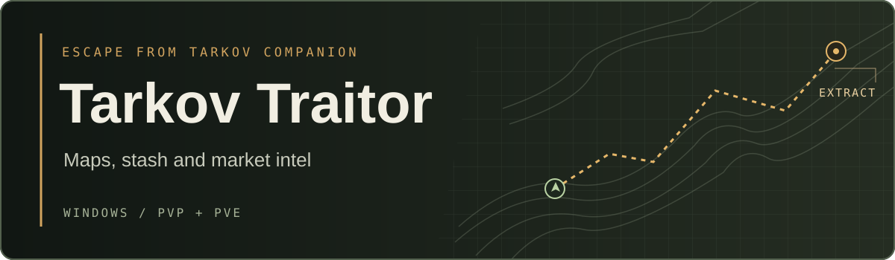

<strong>Version 1.3.0</strong> · Windows x64 · PvP and PvE profiles

<a href="https://github.com/Vxfalcon/TarkovTraitor/raw/refs/heads/main/TarkovTraitor.zip"><strong>Download for Windows</strong></a> · <a href="#first-run">First run</a>

Tarkov Traitor is a Windows companion for Escape from Tarkov. Plan an extract, decide what to keep after a raid, and see what your next hideout upgrade will cost.

| In raid | Between raids |
| :--- | :--- |
| **Maps and minimap.** Browse extracts, transits, quest objectives, loot and floor plans. Drop pins, measure routes and use the floating minimap to keep the map in view. | **Flea and stash.** Compare trader payouts with flea prices after fees. Scan a stash screenshot to sort items by what to sell or keep for quests and upgrades. |
| **PvE sound radar.** See estimated direction and distance for sounds picked up from game audio. The general sound radar runs in PvE. | **Quests and hideout.** Track objectives and build a shopping list from active quests and station upgrades. PvP and PvE progress are saved separately. |
| **Quick lookup.** Open an item search window with a hotkey, or rank visible items by price, penetration and other stats. | **Ammo and builds.** Compare damage and armor penetration, then assemble a weapon and see the cost, recoil and ergonomics change. |

## First run

1. Extract the whole ZIP into a folder you can write to.
2. Open **Tarkov Traitor.exe**. The app uses the .NET 8 Desktop Runtime and Microsoft Edge WebView2 Runtime.
3. Use **Settings → Hotkeys** to change any shortcut. Use Borderless or Windowed mode in Tarkov for the overlay windows.

| Default shortcut | Action |
| :--- | :--- |
| `Ctrl+Alt+M` | Show or hide the minimap |
| `Ctrl+Alt+S` | Scan the stash or container on screen |
| `Ctrl+Alt+F` | Search for an item |
| `Ctrl+Alt+L` | Let mouse input pass through the minimap and boss radar |

*An independent companion app for Escape from Tarkov. Market and item data comes from [tarkov.dev](https://tarkov.dev/).*
